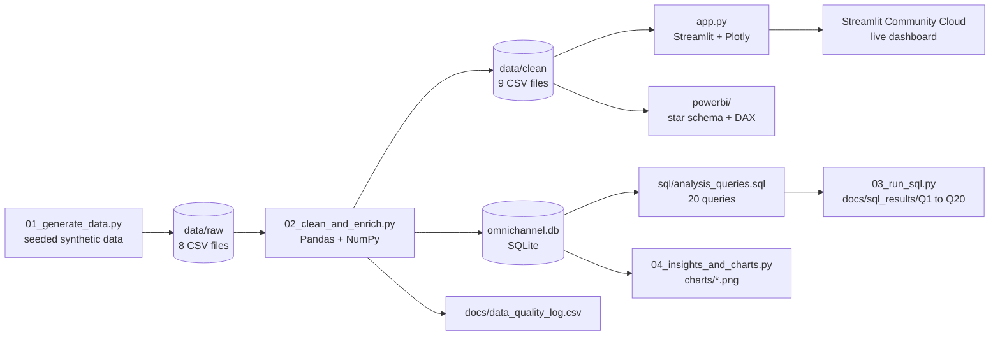
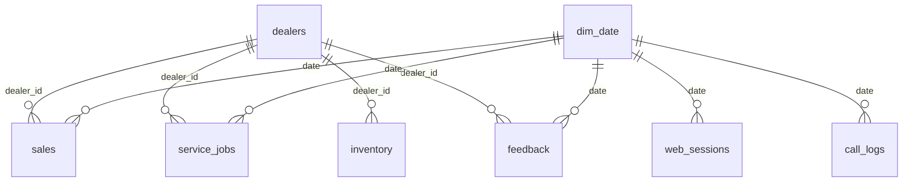

# AutoNova: Omnichannel Sales, Customer Experience & Call Center Analytics

[](https://autonova-atqsxjckudd9qyyfusek3y.streamlit.app)

**Live dashboard:** https://autonova-atqsxjckudd9qyyfusek3y.streamlit.app

An end-to-end analytics project for a fictional car brand with 28 dealers in four regions, a website, a chatbot, a connected app, marketing campaigns, NPS surveys and a call center. It takes raw data through cleaning, SQL analysis and an interactive dashboard, and ends in findings written for business teams.

**Tools:** SQL (SQLite) | Python (Pandas, NumPy, Matplotlib) | Streamlit and Plotly | Power BI data model and DAX | Git and GitHub

> **Data note.** The data is synthetic. I generated it with a seeded Python script and planted a few patterns on purpose (slow service at four dealers, a weak paid channel, billing-heavy complaints) so the analysis has something to detect. The findings demonstrate method. They are not real business results.

---

## Business questions

1. Which dealers and regions underperform on sales, service and inventory?
2. Which channels and campaigns convert, and at what cost?
3. Why is NPS low, and what do detractors complain about?
4. Which call types and agents drive negative customer sentiment?
5. Is the weak mobile conversion real, or an effect of traffic mix?

## What was built

| Component | Status |
| --- | --- |
| Synthetic data generator (8 tables, about 138,000 rows) | Done |
| Cleaning and enrichment pipeline (Pandas, NumPy) with a data-quality log | Done |
| SQL analysis, 20 queries (joins, CTEs, window functions) | Done |
| Interactive dashboard, 6 pages (Streamlit and Plotly) | Done, [deployed](https://autonova-atqsxjckudd9qyyfusek3y.streamlit.app) |
| Power BI star-schema model and 51 DAX measures | Designed and documented in `powerbi/`. Not yet built and validated in Power BI Desktop |

---

## Architecture



| Layer | What happens | Files |
| --- | --- | --- |
| Ingest | A seeded script creates 8 tables with seasonality, planted patterns and deliberate dirt (duplicates, blanks, typos, outliers). | `python/01_generate_data.py` |
| Clean and enrich | Remove duplicates, fill or flag blanks, fix outliers, standardise text. Add features (period, festive flag, NPS category, delay flag, AOV and aging buckets). Tag survey comments by theme with keyword rules. Build a date dimension. Log every fix. | `python/02_clean_and_enrich.py` |
| Store | Clean tables are written to CSV (for the app and Power BI) and to SQLite (for SQL). | `data/clean/`, `data/omnichannel.db` |
| Analyse (SQL) | 20 queries answer the business questions. Results are saved as CSV. | `sql/analysis_queries.sql`, `python/03_run_sql.py` |
| Visualise | A 6-page Streamlit app reads the clean CSVs and recomputes every figure from the records. Each page opens with a headline sentence calculated from the data. | `app.py` |
| Deploy | The app runs on Streamlit Community Cloud, built from this repository. | `requirements.txt`, `.streamlit/config.toml` |
| Model (Power BI) | Star-schema design, relationships and 51 DAX measures for the same analysis. | `powerbi/` |

### Data model



`campaigns` is analysed by channel and quarter. `web_sessions` and `call_logs` are not tied to a dealer, so the dashboard's region filter does not apply to them.

### Data tables (after cleaning)

| Table | Rows | One row is |
| --- | --- | --- |
| dealers | 28 | a dealer, with region and monthly sales target |
| sales | 18,000 | an order |
| service_jobs | 20,000 | a service job card |
| inventory | 2,688 | dealer, product and month-end stock snapshot |
| campaigns | 144 | a marketing campaign |
| web_sessions | 60,000 | a website, chatbot or app session |
| feedback | 12,000 | an NPS survey response |
| call_logs | 25,000 | a call center call |
| dim_date | 731 | a calendar day, 2024 to 2025 |

---

## Data cleaning

Every fix is logged in `docs/data_quality_log.csv`.

| Issue | Rows | Action |
| --- | --- | --- |
| Duplicate IDs (sales 90, service 100, web 180, feedback 60, calls 100) | 530 | Dropped, keeping one copy |
| Missing payment mode | 180 | Filled with "Unknown" |
| Missing device | 600 | Filled with "Unknown" |
| Missing call sentiment | 250 | Filled with "Neutral" (an assumption, documented) |
| Missing service turnaround | 200 | Filled with the median for that job type |
| Sales amounts about 50 times too high | 15 | Replaced with the product median |
| Inconsistent text case in call issue type | 220 | Standardised to Title Case |
| Missing survey comments | 120 | Left blank and excluded from theme analysis |

---

## SQL analysis

All 20 queries are in `sql/analysis_queries.sql`. Results are in `docs/sql_results/`.

| Query | Question | Techniques |
| --- | --- | --- |
| Q1 | Company KPI snapshot | Subqueries |
| Q2 | Monthly sales and month-over-month growth | CTE, `LAG` |
| Q3 | Dealer rank within each region | `JOIN`, `RANK() OVER (PARTITION BY ...)` |
| Q4 | Sales against target by dealer | `JOIN`, aggregation |
| Q5 | Product mix share of revenue | `SUM() OVER ()` |
| Q6 | Festive-quarter lift | Conditional grouping |
| Q7 | Service turnaround by dealer, red-flag rule | CTE, subquery, `CASE` |
| Q8 | Service revenue and turnaround by job type | Aggregation |
| Q9 | Aged inventory at the latest snapshot | Subquery in `WHERE`, conditional `SUM` |
| Q10 | Months of stock cover per dealer | Two CTEs, join |
| Q11 | Conversion and AOV by traffic source | Conditional aggregation |
| Q12 | Conversion by platform and device | Multi-column `GROUP BY` |
| Q13 | Chatbot: escalated versus handled by the bot | Conditional aggregation |
| Q14 | Campaign ROI and cost per lead by channel | Aggregation |
| Q15 | Best and worst campaign per channel | `ROW_NUMBER` |
| Q16 | NPS by dealer with promoter and detractor split | Conditional aggregation |
| Q17 | Do slow-service dealers have lower NPS? | CTEs, join |
| Q18 | Detractor themes | Window share |
| Q19 | Call types: volume, resolution, negative share | Window share |
| Q20 | Agent scorecard with quartiles | CTE, `NTILE` |

---

## Dashboard (6 pages)

| Page | What it shows |
| --- | --- |
| Overview | Sales, target achievement, conversion, AOV, NPS, call resolution. Monthly sales with the festive months shaded. Revenue by product. Achievement by region. |
| Digital | Conversion by traffic source. A mix-effect check on mobile against desktop within each source. Platform and device heatmap. Chatbot escalation outcomes. |
| Dealers | Scorecard with a CSV download. Service speed against NPS. Lowest target achievement. A dealer-detail view with monthly sales against target and detractor themes. |
| Marketing & NPS | Campaign ROI, cost per lead and per sale, spend against sales per campaign. NPS trend, promoter and detractor mix, detractor themes. |
| Call center | Share of negative calls by issue, sentiment split, agent scatter, a coaching list, negative calls over time. |
| Findings & method | Seven findings computed from the full dataset, the cleaning log, table counts and limits of the analysis. |

Filters for year, quarter and region apply across the pages where the data is linked to a dealer.

---

## Key findings

Figures are for the full period (2024 to 2025) and come from the queries above.

| Finding | Evidence | Suggested action |
| --- | --- | --- |
| Four dealers drive the NPS problem | Kolkata Motors 1 and 2 and Patna Motors 1 and 2 average 5.0 days of service turnaround against 2.6 elsewhere. NPS is -64 against +20 for the other 24 dealers. They reach 55% to 72% of sales target and hold 5.6 to 6.7 months of stock against about 3 for most dealers. | Audit service capacity before changing sales incentives. |
| Paid Social is large but rarely converts | 25% of web sessions, 1.0% conversion against 4.37% overall, 1.1x ROI (Google Search 4.0x, Email 31x). | Retarget or cut the weakest creative and shift budget gradually, testing as spend grows. |
| Mobile converts worse, even within one channel | 3.8% on mobile against 5.5% on desktop, lower in 7 of 7 sources, so traffic mix does not explain it. | Audit the mobile booking and checkout flow. |
| Chatbot escalations lose sales | Escalated sessions convert at 1.5% against 4.4% when the bot handles them. This is an association, since escalated cases may be harder. | Fix the top escalation reasons and add a warm hand-off. |
| Billing disputes cause most unhappy calls | 20% of call volume but 48% of negative calls. 68% end negative, 51% are resolved, 11.5 minutes average handling time. Billing and service delay make up 50% of detractor comments (keyword-based, approximate). | Create a billing specialist queue and clearer invoices. |
| Agent results vary widely | Resolution from 53% to 82% and satisfaction from 2.51 to 3.87 across 40 agents (lowest and highest single agents). | Coach the lowest-satisfaction quarter on billing calls. |
| October to December is the peak | Monthly sales in those months are 2.3x the average of other months. | Plan stock, staffing and campaign budget for the peak. |

---

## Power BI

The `powerbi/` folder contains the design for the same analysis in Power BI:

| File | Purpose |
| --- | --- |
| `data_model.md` | Star schema, nine many-to-one relationships, modelling notes |
| `dax_measures.dax` | 51 measures for sales, digital, service, inventory, marketing, NPS and call center (time intelligence, `CALCULATE`, `RANKX`, `DIVIDE`, `SWITCH`) |
| `dashboard_build_guide.md` | Page-by-page layout for a 5-page report |
| `POWER_BI_DEPLOY.md`, `build_powerbi_workbook.py` | Build and publish notes, and a script that packs the clean tables into one Excel workbook |

**Status:** the model and measures are written and documented. Power BI Desktop runs only on Windows, and I develop on a Mac, so the dashboard was built in Streamlit. Building and validating the Power BI version is the next step.

---

## Run it locally

```bash
git clone https://github.com/raghuvendra34/AutoNova.git
cd AutoNova
pip install -r requirements.txt

# rebuild the data and analysis (about a minute)
./run_all.sh
# or, on Windows, run the four scripts in /python in order: 01, 02, 03, 04

# start the dashboard
streamlit run app.py
```

The cleaned data is already in `data/clean/`, so `streamlit run app.py` works without re-running the pipeline.

## Deployment

The app is deployed on Streamlit Community Cloud from this repository (branch `main`, main file `app.py`, Python 3.12). It needs three things from the repo: `requirements.txt`, the CSVs in `data/clean/`, and `.streamlit/config.toml` for the light theme. Free apps sleep after a period of inactivity, so the first load can take about 30 seconds.

## Project structure

```
.
├── app.py                      Streamlit dashboard (6 pages)
├── requirements.txt
├── run_all.sh                  runs the pipeline
├── .streamlit/config.toml      light theme
├── python/
│   ├── 01_generate_data.py     synthetic data with planted patterns
│   ├── 02_clean_and_enrich.py  cleaning, features, SQLite load
│   ├── 03_run_sql.py           runs the 20 queries
│   ├── 04_insights_and_charts.py
│   └── build_powerbi_workbook.py
├── sql/analysis_queries.sql    20 queries
├── data/
│   ├── raw/                    generated, with injected dirt
│   ├── clean/                  cleaned tables (used by the app)
│   └── omnichannel.db          SQLite database
├── docs/
│   ├── data_dictionary.md
│   ├── data_quality_log.csv
│   └── sql_results/            Q1 to Q20 outputs
├── charts/                     static PNG charts
└── powerbi/                    model, DAX and build guide
```

## Limits of this analysis

- The patterns were planted, so they are easier to find than in real data. This project shows method, not business impact.
- Theme and sentiment tags on survey comments come from keyword rules, so they are approximate and miss sarcasm.
- Correlation is not cause. A slow dealer with low NPS may have other problems.
- Budget moves implied by channel ROI assume cost per sale holds as spend grows, which it usually does not.
- The Power BI measures have not yet been validated in Power BI Desktop.

## Possible next steps

Build and publish the Power BI report, add customer segmentation (RFM), try a lead-scoring model, replace keyword tagging with a proper sentiment model, and schedule a monthly refresh.

## Author

**Raghuvendra Kumar** | [LinkedIn](https://www.linkedin.com/in/raghuvendra-kumar-76919128a/) | [GitHub](https://github.com/raghuvendra34) | raghuvendrakumar34@gmail.com
